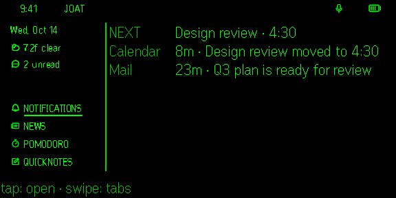
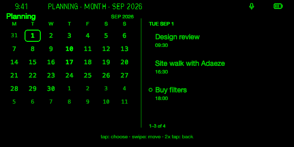
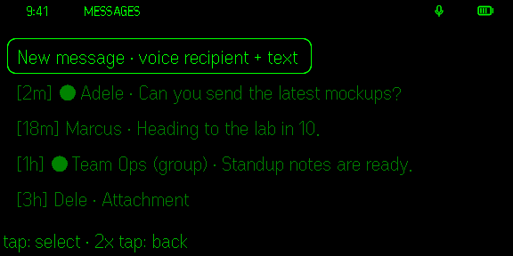
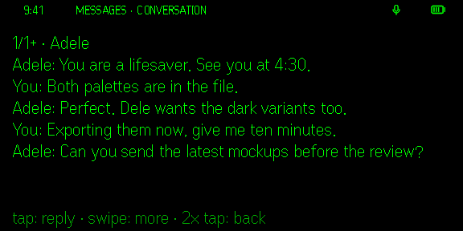
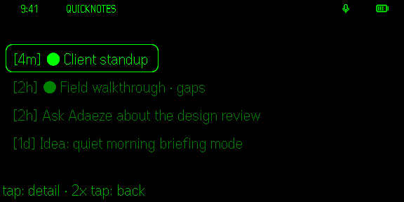
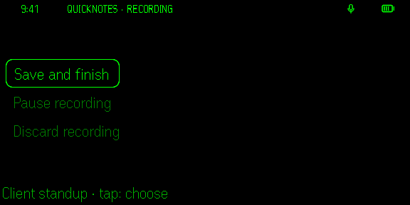
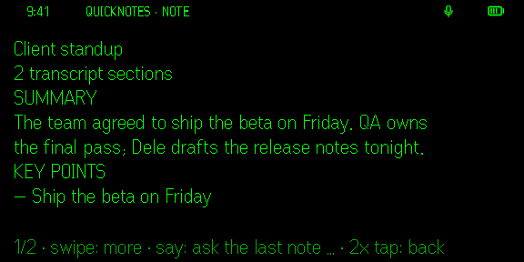
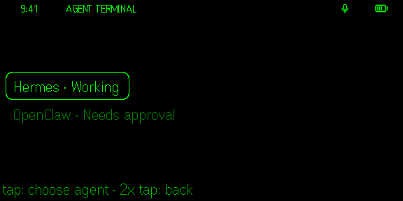
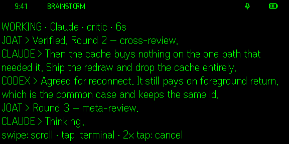
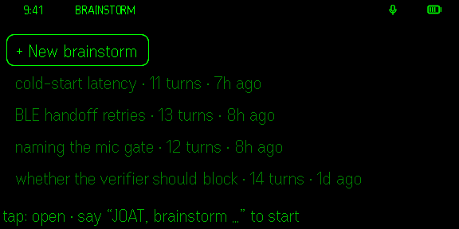

# JOAT // Even Realities G2

A personal AI assistant for the Even Realities G2 smart glasses, powered by an always-on Mac Studio (the brain) and an iPhone (relay/companion). Voice in, HUD out — with a cited planning debate loop (Codex proposes, Claude critiques, local MLX judges) gated by a source Verifier that denies anything it can't verify against the live web.

## On the glasses

The G2's 576×288 display, captured in Even's official simulator with demo data (the `?joatVisual=<state>` fixtures in [docs/TESTING.md](docs/TESTING.md)).

| | |
|---|---|
| <br>**Home**: next event, unread, tabs | <br>**Planning**: calendar and reminders on one month |
| <br>**Messages**: threads, new message by voice | <br>**Conversation**: tap to reply |
| <br>**QuickNotes**: recordings and text notes | <br>**Recording**: save, pause or discard |
| <br>**Note**: summary, key points, to-dos | <br>**Agent Terminal**: pick an agent, speak to it |
| <br>**Brainstorm**: Codex and Claude debate live | <br>**Brainstorm sessions**: resume a past one |

## System at a glance

```
G2 glasses (BLE, 576x288 HUD, LC3 mic)
   │
   ├── Mac direct-BLE (at desk, lowest latency)
   └── iPhone (Even Hub relay → later: custom background-BLE companion)
   │
Mac Studio brain
   ├── STT (WhisperKit / Parakeet-MLX) + wake word
   ├── The mind: claude -p (Max) or codex exec (ChatGPT) — subscriptions, never keys; the brain's tools over MCP; local MLX as the offline seat + debate Judge
   ├── Even AI door: OpenAI-shaped endpoint for Even's own assistant (Agent Configure)
   ├── Debate loop: Codex CLI (Proposer) ⇄ Claude CLI (Critic) ⇄ Verifier Gate
   ├── Computer use (cua + Lume sandbox, iPhone Mirroring)
   └── Channels (iMessage, Mail, Calendar, FaceTime via BlackHole)
```

## Repository layout

```
utilsG2/
├── docs/                     # Architecture, roadmap, rules, Mac app, starter repos
├── apps/
│   ├── mac/joat/           # Python package — the brain (OOP, layered)
│   │   ├── core/             # Domain models, abstract interfaces, events
│   │   ├── ble/              # G2 transport adapters (direct-BLE, gateway client)
│   │   ├── audio/            # LC3 decode, STT engines, VAD/wake word
│   │   ├── display/          # HUD renderer (576x288 canvas, pages, cards)
│   │   ├── agents/           # Proposer / Critic / Judge classes + loop state machine
│   │   ├── verifier/         # Verifier Gate (fetch, quote-match, NLI, Wayback)
│   │   ├── channels/         # iMessage, Mail, Notification triage
│   │   ├── computeruse/      # cua driver, iPhone Mirroring adapters
│   │   └── services/         # Orchestrator, session, handoff manager
│   ├── ios-companion/        # Phase 5: Swift background-BLE companion
│   └── hub-plugin/           # Even Hub SDK plugin (TypeScript + Vite)
├── vendor/                   # Cloned third-party repos (see docs/STARTER_REPOS.md)
├── config/                   # App config, schemas, allowlists
├── scripts/                  # Setup, clone-vendors, dev helpers
└── tests/                    # unit/ and integration/
```

## Docs

| Doc | Contents |
|---|---|
| [docs/ARCHITECTURE.md](docs/ARCHITECTURE.md) | Components, OOP design, interfaces, data flow, debate loop + Verifier Gate |
| [docs/ROADMAP.md](docs/ROADMAP.md) | Phases 0–5 with success metrics |
| [docs/RULES.md](docs/RULES.md) | Engineering rules, safety gates, ToS constraints |
| [docs/MAC_APP.md](docs/MAC_APP.md) | Mac Studio brain — detailed design |
| [docs/HUB_PLUGIN.md](docs/HUB_PLUGIN.md) | Even Hub SDK reference — the relay path, container model, audio/IMU/location APIs |
| [docs/STARTER_REPOS.md](docs/STARTER_REPOS.md) | Verified GitHub repos to clone so we don't build from zero |
| [docs/TESTING.md](docs/TESTING.md) | Three testing tiers (vitest / simulator / glasses), event-shape probe, nod calibration |
| [docs/NEXT_STEPS.md](docs/NEXT_STEPS.md) | What to do next, in order, and what's deliberately deferred |

## Run your own

JOAT is not on the Even Hub store: Even Hub fixes a plugin's network
whitelist at packaging time with no wildcards, so every install is built for
its owner's own Mac. Everything personal lives in two ignored `.env` files;
nothing about your Mac is committed.

You need a Mac (Apple silicon), Even G2 glasses with the Even Realities App,
[Tailscale](https://tailscale.com) on the Mac and the phone, an Even Hub
developer account, and an Apple Developer account to sign `JOAT.app`.

1. **Mac engine.** Clone this repo, then run `./scripts/setup_brain.sh`
   (Python venv, dependencies, WhisperKit, tests).
2. **Mac app.** `cp .env.example .env`, set `JOAT_TEAM_ID` to your Apple team
   ID, then `./scripts/build_app.sh --install`. In JOAT.app's Settings, turn on
   **Private Tailnet home brain** and restart it.
3. **Private HTTPS route.** On the Mac:
   `tailscale serve --bg --set-path /glasses http://127.0.0.1:8787`
4. **Your plugin build.** In `apps/hub-plugin`: `cp .env.example .env`, set
   `JOAT_PACKAGE_ID` (your own reverse-domain id) and `JOAT_RELEASE_WS_URLS`
   (`wss://<your-mac>.<your-tailnet>.ts.net/glasses`), then
   `npm ci && npm run pack`. Upload the resulting `joat.ehpk` to your own
   Even Hub developer project and install it on your phone.
5. **Pair once.** Open JOAT.app's pairing window, then open JOAT on the
   glasses. See [docs/MAC_APP.md](docs/MAC_APP.md) for details.

## Key constraints (read RULES.md before coding)

- HUD canvas is **576×288 monochrome green** — build against this only.
- One BLE central per lens; handoff = disconnect → rescan → 7-packet auth replay → resend page state.
- Claude critic: invoke the official `claude` binary only; never reuse OAuth tokens in third-party clients.
- Every consequential computer-use action requires explicit confirmation (IMU nod or R1 ring).
- Stay on stock G2 firmware (ECDSA-P256-signed images block custom firmware).

## License

[MIT](LICENSE)
