# JOAT // Even Realities G2

A phone-first AI assistant, coding terminal, route-schematic navigator, and Apple Pencil notebook for the **Even Realities G2** smart glasses (`576×288` monochrome green waveguide), powered by **JOAT Brain** on the iPhone paired with an optional home **Mac** (`JOAT.app`) over private Tailscale relays.

Voice in, waveguide HUD out: when paired to **This iPhone · JOAT Brain** (`ws://127.0.0.1:8787/glasses`), the Even Hub plugin keeps its WebSocket pinned locally on the iPhone (`0` mid-session brain switches) so on-device speech recognition (`SpeechAnalyzer`) and the 30-tool **JOAT Assistant** (`Gemini 3.5 Flash Lite` / `Claude` + `<50 ms` local fast handlers) respond with minimal latency — while reaching your home Mac in the background over Tailscale HTTPS for full iMessage history (`/messages`), **Claude Code / Codex / Antigravity** coding sessions (`/terminal`), and optional subscription CLI reasoning (`/agent`). At a desk or without `JOAT Brain`, the glasses can also connect directly to `JOAT.app` on the Mac over Tailscale (`wss://`) or direct BLE.

> **Demo Video (`1080p`):** [docs/demo/joat-hackathon-demo.mp4](docs/demo/joat-hackathon-demo.mp4) — end-to-end walkthrough of `evenhub-simulator` + `JOAT Brain` iPhone Simulator (`Gemini 3.5 Flash Lite` voice assistant, R1-safe BLE coexistence, heading-up vector navigation schematic, Apple Pencil post-close note insights, standalone Gmail, and `Agent Terminal`), narrated with `gemini-3.8-flash-tts`, scored with `lyria-3.5`, and framed with `gemini-omni-1.2-flash`.

---

## On the glasses (`576×288` Even G2 HUD)

Captured in `evenhub-simulator` (`576×288` monochrome green waveguide) with synthetic demo data (see [docs/TESTING.md](docs/TESTING.md)).

| | |
|---|---|
| 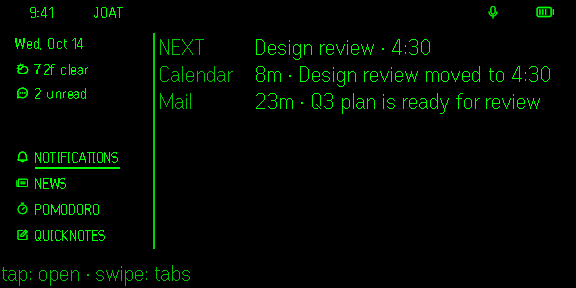<br>**Home**: next event, unread count, rail tabs | 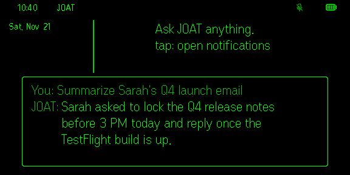<br>**JOAT Assistant**: floating multi-turn card, `JOAT · LISTENING` spine, 30 tools |
| 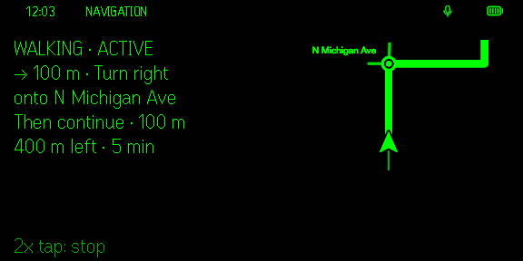<br>**Navigation**: heading-up route schematic, Walk / Cycle / Drive, next-turn street callout | 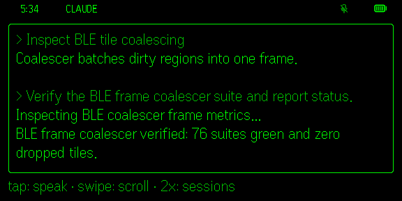<br>**Agent Terminal**: framed dual-brightness session for Claude, Codex & Antigravity |
| 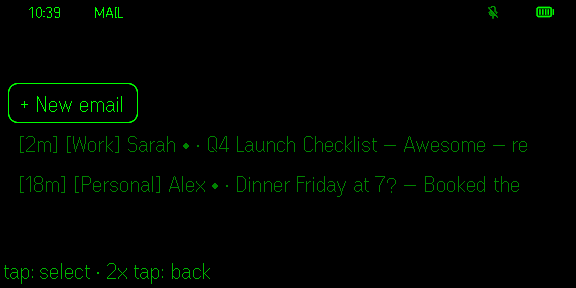<br>**Mail**: multi-account Gmail inbox, thread reader & voice reply | 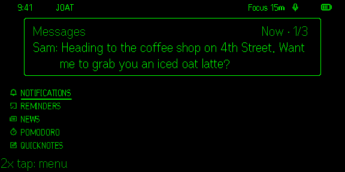<br>**Notifications**: true arrival age (`15m ago · 1/3`), persistent `tap` / `2x tap` dismissal sync |
| 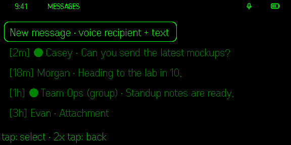<br>**Messages**: Mac `/messages` relay threads, multi-clause voice dictation | 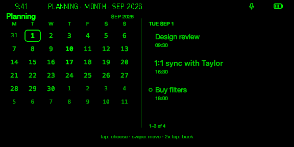<br>**Planning**: calendar & EventKit reminders on one month |
| 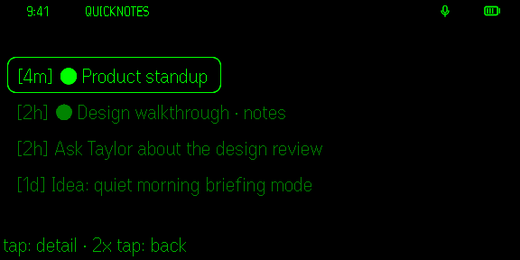<br>**QuickNotes**: voice & Apple Pencil notes, optional AI cues from Prep folders | 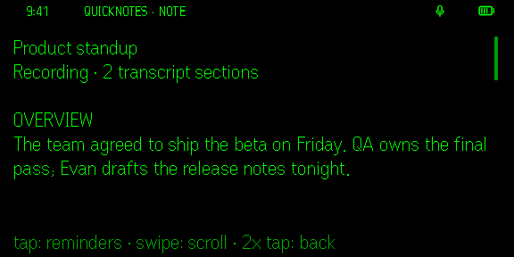<br>**QuickNote Summary**: post-close AI overview, key points & one-tap reminders |

### Glasses HUD highlights

- **Heading-up route schematic (`NavigationSchematic.ts`)** — Replaces noisy 4-bit street bitmaps with a crisp vector route diagram projected from live route geometry and GPS fixes: fixed wearer chevron at lower-centre, bright remaining route, dim travelled route, ringed next-maneuver node with street name, cross-street stubs, dashed off-route connector, 1-tap **Saved Places**, live `"Where to?"` speech-in-text, and **Walk / Cycle / Drive** modes.
- **Multi-turn JOAT Assistant (`AssistantConversationSurface.ts` + `Brain.swift`)** — Floating conversation card with `JOAT · LISTENING` spine indicator, 1st-try standalone & split phonetic wake + polite lead-in normalization, speech-start follow-up latching across countdown boundaries, automatic `conversationId` rotation on close/handoff, Turn-2 viewport scroll reset, `<50 ms` local fast handlers (time, date, calendar, reminders, notes), `thinkingLevel: "MINIMAL"` SSE tool calling, and hardware **`ConfirmGate`** touchpad consent before sending any email/text or mutating reminders.
- **3-level Framed `Agent Terminal` (`NativeTerminalSurface.ts` + `GlassesTerminal.swift`)** — Pick **Claude**, **Codex**, or **Antigravity** → resume a past session or `+ New session` → speak instructions into a 5-container dual-brightness card (dim `> ` user / `>> ` tool rows, full-width bright assistant prose, boxed touchpad approvals, and `0 ms` tap-to-commit dictation).
- **Even R1 Ring & Bluetooth Coexistence (`DeviceMonitor.ts`, `AudioStreamer.ts`, `BleDiagnostics`)** — Filters `onDeviceStatusChanged` by G2 serial number so Even R1 ring flaps never mute the G2 mic, automatically recovers listening across app switches, and offers **Always On (Glasses Mic)**, **Hold to Talk (R1-Safe — `0 pkt/s` idle BLE audio)**, and **Phone Mic (R1-Safe)** modes alongside live Bluetooth route diagnostics.
- **Multi-clause dictation & persistent notifications (`Prompts.swift`, `Cards.swift`, `NotificationCard.ts`)** — Spoken message/email/terminal bodies accumulate across mid-sentence pauses (`1.5 s` settle window + sliding volatile extensions), while incoming `Messages` and `Mail` cards preserve true arrival timestamps and sync 200-ID FIFO dismissal tombstones across reconnects.

---

## On the iPhone & Foldable Duo (`JOAT Brain`)

`JOAT Brain` runs the glasses brain locally on the iPhone (including behind Even Hub and with the screen locked) in a 4-tab **G2 Phosphor Emerald** interface (`Home`, `Mail`, `Notes`, `Agents`) with responsive compact and unfolded Duo split views. See [docs/IOS_APP.md](docs/IOS_APP.md).

| | | |
|:-:|:-:|:-:|
| 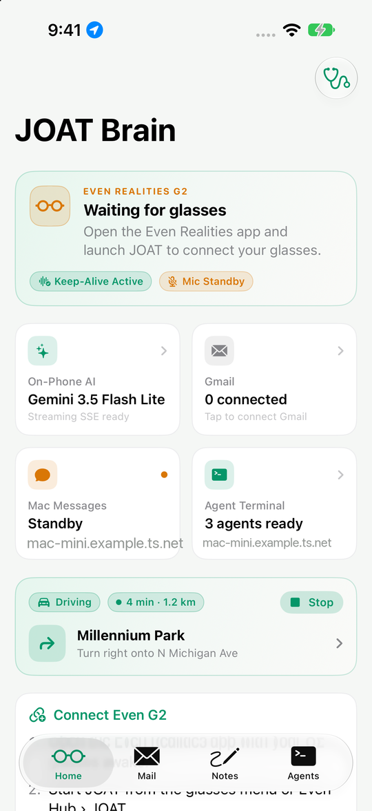<br>**Home**: Even G2 hero card, 2×2 subsystem tiles & live route card | 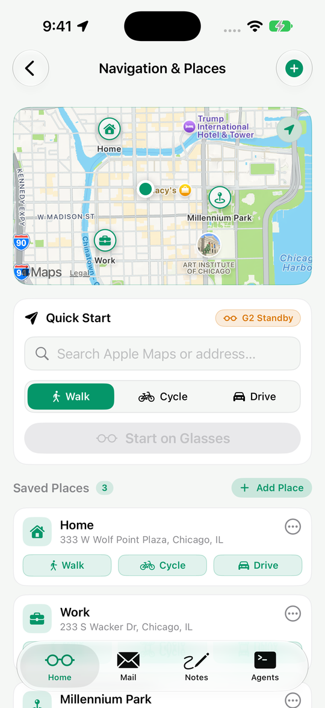<br>**Navigation & Places**: Apple Maps search, Saved Places & `Walk \| Cycle \| Drive` | 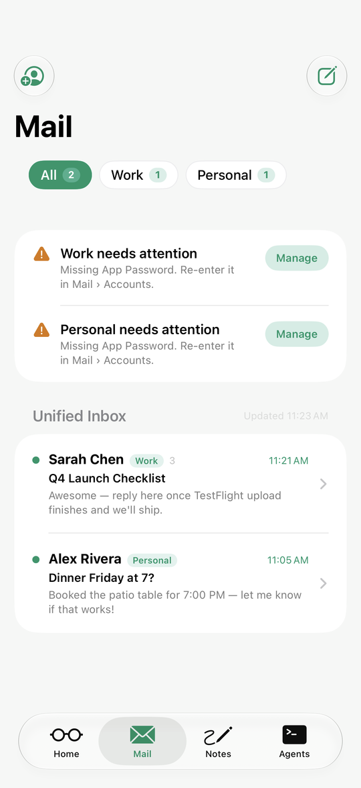<br>**Mail**: standalone multi-account Gmail over TLS IMAP/SMTP |
| 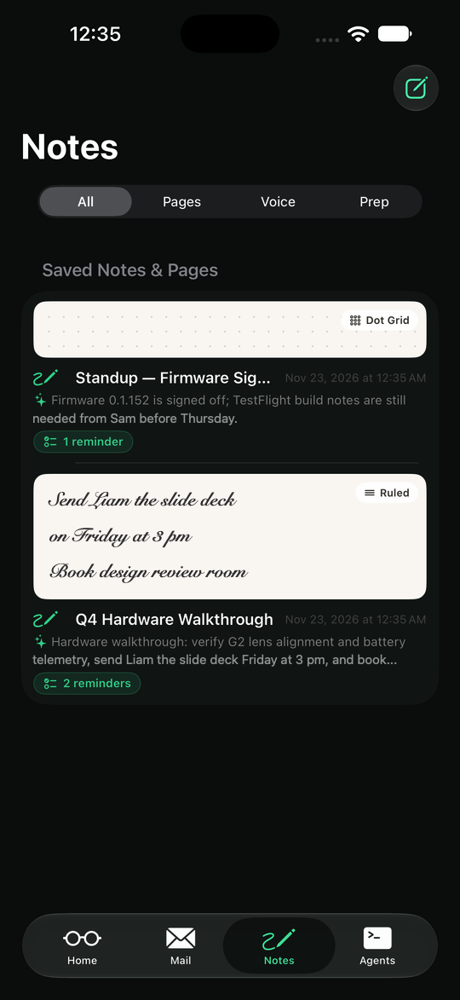<br>**Notes**: `All \| Pages \| Voice \| Prep` with inline AI summaries & reminder badges | 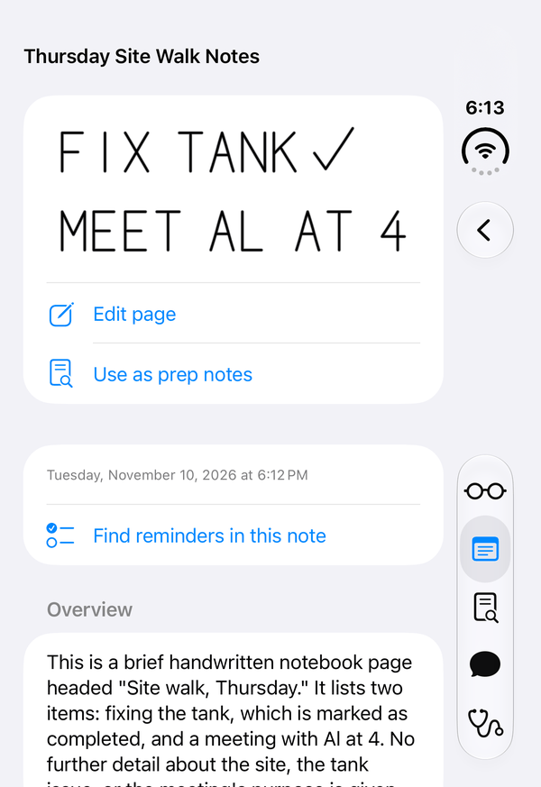<br>**Apple Pencil Page**: post-close AI summary/insights, handwriting OCR & `0.5×–4×+` zoom | 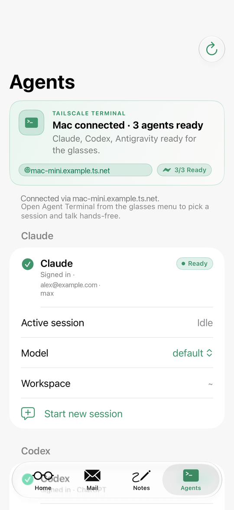<br>**Agents**: Tailscale `/terminal` models, workspaces & sessions |

### `JOAT Brain` highlights

- **Home, R1-Safe Voice & Navigation Hub** — Live Even G2 connection status, 2×2 subsystem tiles (**On-Phone AI**, **Gmail**, **Mac Messages**, **Agent Terminal**), **Glasses Mic Mode** (**Always On**, **Hold to Talk · R1-Safe**, **Phone Mic · R1-Safe**), **Navigation & Places** with Apple Maps autocomplete, custom emerald `Home` / `Work` pins, side-by-side MapKit route preview on unfolded Duo, route-only `CLBackgroundActivitySession` lock-screen GPS, and optional spoken turn-by-turn cues in headphones.
- **Apple Pencil Notebook & Post-Close AI Insights (`Notebook.swift`, `NotesInsights.swift`)** — Warm `#FAF8F4` US Letter stationery (`Ruled`, `Dot Grid`, `Grid`, `Blank`) with lag-free background auto-save, `Write | Type` toggle, **pinch zoom out to `0.5×` width-fit (centred) and in to `4×+`**, **post-close handwriting OCR & AI summarization** (`Gemini 3.5 Flash Lite` / `Claude`) across handwritten pages, Voice QuickNotes, and Quick Text Notes, and full `AI cues during QuickNotes` toggle parity across glasses and app.
- **Standalone Multi-Account Gmail (`MailView.swift`, `GmailTransport.swift`)** — Direct TLS IMAP (`imap.gmail.com:993`) and SMTP (`smtp.gmail.com:465`) with Keychain App Passwords, `All | Work | Personal` filtering, threaded conversations, and full glasses parity.
- **Agents Control Plane (`MacTerminal.swift`)** — Configure models, workspaces, accounts, and new sessions for **Claude**, **Codex**, and **Antigravity** on the phone so raw model IDs never clutter the glasses HUD.

---

## System architecture

```text
Even Realities G2 (576×288 green waveguide, dual-BLE lenses, LC3 mic, temple touchpad + IMU)
   │
   ├── [Mobile / Default] Even Hub Plugin (apps/hub-plugin, TypeScript + Vite)
   │      │   Pinned WebSocket: ws://127.0.0.1:8787/glasses (zero mid-session BrainHandoff)
   │      ▼
   │   JOAT Brain on iPhone (apps/ios-companion, Swift + Background Audio Keep-Alive)
   │      ├── LoopbackServer (127.0.0.1:8787) + Transcriber (SpeechAnalyzer STT) + WakeGate
   │      ├── Prompts (1.5 s multi-clause dictation + pre-prompt speech fence + 0 ms tap commit)
   │      ├── Brain + OnPhoneAI (Gemini 3.5 Flash Lite / Claude + <50 ms local fast handlers)
   │      ├── PhoneToolBelt (30 tools) + ConfirmGate (hardware touchpad consent on writes/sends)
   │      ├── Native iOS features:
   │      │     ├── Navigation (MapKit Directions + PhoneLocation GPS + headphone Voice cues)
   │      │     ├── Mail (direct TLS IMAP/SMTP Gmail + MIMEParser + Keychain)
   │      │     ├── Notes (PencilKit Notebook + post-close OCR & NotesInsights + optional Prep cues)
   │      │     └── EventKit Calendar & Reminders + persistent Cards (200-ID FIFO tombstones)
   │      └── Private Tailscale HTTPS relays to Home Mac (optional, background):
   │            ├── /messages ──► MessagesEndpoint (macOS chat.db threads, ?q= search, send)
   │            ├── /terminal ──► TerminalEndpoint (Claude / Codex / Antigravity sessions & approvals)
   │            └── /agent    ──► AgentEndpoint (subscription CLI mind fallback)
   │
   └── [Desk / Direct-Mac] wss://<mac>.<tailnet>.ts.net/glasses  OR  Mac direct-BLE
          ▼
       JOAT.app on Mac mini / Mac Studio (apps/mac/joat, Python + Swift menu-bar shell)
          ├── Audio pipeline: WhisperKit / Parakeet-MLX STT + adaptive RMS VAD + wake gate
          ├── Reasoning & coding: Claude CLI (`claude -p`), Codex CLI (`codex exec`), Antigravity + MCP tools
          ├── Relay services: /messages, /terminal, /agent, /mcp (guarded by per-service bearer tokens)
          └── Channels & computer use: iMessage, Mail, Calendar, Verifier Gate, cua + Lume sandbox
```

---

## Repository layout

```text
joatGlass/
├── apps/
│   ├── hub-plugin/               # Even Hub SDK plugin (TypeScript + Vite + joat.ehpk package)
│   │   ├── joat.ehpk             # Packaged Even Hub plugin build
│   │   └── src/                  # HUD surfaces, NavigationSchematic, AssistantConversationSurface,
│   │                             # NativeTerminalSurface, NotificationCard, EventRouter, HudPresenter
│   ├── ios-companion/            # JOAT Brain iPhone & Duo app (SwiftUI + XcodeGen)
│   │   ├── Sources/              # Brain, WakeGate, OnPhoneAI, AssistantTools (30 tools), Prompts,
│   │   │                         # GlassesTerminal, MacTerminal, MacMessages, Mail, Navigation,
│   │   │                         # Notebook, NotesInsights, QuickNotes, Reminders, Cards, AppScreens
│   │   └── Shortcuts/            # Optional iOS Shortcuts fallback when running without a home Mac
│   └── mac/joat/                 # Home Mac engine & background Tailscale relays (Python, layered OOP)
│       ├── core/                 # Domain models, protocol contracts, abstract interfaces
│       ├── ble/                  # Direct-BLE & Hub gateway transports
│       ├── audio/                # LC3 decode, WhisperKit / Parakeet-MLX STT, adaptive VAD
│       ├── display/              # 576×288 canvas renderer & page builders
│       ├── agents/               # Claude / Codex / Antigravity CLI & A2A/OpenClaw terminal adapters
│       ├── verifier/             # Live-web Verifier Gate (fetch, Wayback, quote-match, NLI)
│       ├── channels/             # macOS iMessage (`chat.db`), Mail, Notification triage
│       ├── computeruse/          # Sandboxed cua + Lume & iPhone Mirroring drivers
│       └── services/             # VoiceOrchestrator, MessagesEndpoint, TerminalEndpoint, AgentEndpoint
├── docs/                         # Architecture, iOS app, Mac app, Hub plugin, testing, rules & demo video
│   └── demo/joat-hackathon-demo.mp4
├── scripts/                      # Build/deploy scripts (`build_ios.sh`, `build_app.sh`) & simulator E2Es
└── tests/                        # `tests/ios/` Swift suites + `tests/unit/` & `tests/integration/` pytest
```

---

## Docs

| Doc | Contents |
|---|---|
| [docs/ARCHITECTURE.md](docs/ARCHITECTURE.md) | Layered architecture, interfaces, data flow, Mac CLI adapters + Verifier Gate |
| [docs/IOS_APP.md](docs/IOS_APP.md) | `JOAT Brain` on iPhone & Duo — screens, Apple Pencil notebook, 30-tool assistant, Navigation, setup |
| [docs/MAC_APP.md](docs/MAC_APP.md) | `JOAT.app` on Mac — direct brain, Tailscale `/messages` & `/terminal` relays, pairing |
| [docs/HUB_PLUGIN.md](docs/HUB_PLUGIN.md) | Even Hub SDK plugin — container geometry, BLE budget, audio/IMU/location & native surfaces |
| [docs/TESTING.md](docs/TESTING.md) | Vitest, Swift Simulator suites, `evenhub-simulator` E2E flows, and hardware verification |
| [docs/RULES.md](docs/RULES.md) | Engineering rules, privacy/allowlist invariants, `ConfirmGate` safety, ToS constraints |
| [docs/ROADMAP.md](docs/ROADMAP.md) | Project phases and milestones |

---

## Run your own

JOAT is not listed on the public Even Hub store: Even Hub fixes a plugin's network allowlist at packaging time with no wildcards, so every package is built for its owner's endpoints. Personal hostnames, team IDs, and keys live only in gitignored `.env` files — nothing personal is committed.

### Option A (Recommended): Phone-First (`JOAT Brain` on iPhone + Home Mac Relays)

You need an Apple silicon Mac (with Xcode + `brew install xcodegen`), Even G2 glasses with the Even Realities app, [Tailscale](https://tailscale.com) on the Mac and iPhone, an Even Hub developer account, and an Apple Developer account.

1. **Home Mac & Tailscale relays.** Run `./scripts/setup_brain.sh`, copy `.env.example` to `.env` with `JOAT_TEAM_ID`, and install `JOAT.app` via `./scripts/build_app.sh --install`. Expose the private Tailnet paths on your Mac:
   ```bash
   tailscale serve --bg --set-path /glasses  http://127.0.0.1:8787
   tailscale serve --bg --set-path /agent    http://127.0.0.1:8788
   tailscale serve --bg --set-path /messages http://127.0.0.1:8789
   tailscale serve --bg --set-path /terminal http://127.0.0.1:8790
   ```
2. **Build `JOAT Brain` for iPhone.** Update `PRODUCT_BUNDLE_IDENTIFIER` in `apps/ios-companion/project.yml` and `BUNDLE_ID` in `scripts/build_ios.sh` to your own bundle ID, optionally add `GEMINI_API_KEY` / `ANTHROPIC_API_KEY` to `.env` (or enter keys later in `JOAT Brain › Home`), then install on your paired iPhone (or upload to TestFlight):
   ```bash
   ./scripts/build_ios.sh --install --device "<your iPhone>"
   # or: ./scripts/build_ios.sh --testflight
   ```
   `build_ios.sh` automatically seeds your Mac's Tailscale `/messages`, `/terminal`, and `/agent` bearer tokens into `apps/ios-companion/Generated/` (gitignored).
3. **Pack & upload the Even Hub plugin (`phone-first`).** In `apps/hub-plugin/.env`, set `JOAT_PACKAGE_ID`, `JOAT_RELEASE_ALLOW_LOOPBACK=1`, and list `ws://127.0.0.1:8787/glasses` **first** in `JOAT_RELEASE_WS_URLS` (followed by `wss://<your-mac>.<your-tailnet>.ts.net/glasses`). Then pack and upload:
   ```bash
   cd apps/hub-plugin && npm ci && npm run pack
   evenhub upload joat.ehpk --package-id <your-package-id> -m "Initial build"
   evenhub promote <version> --to beta --package-id <your-package-id>
   ```
4. **Connect.** Launch `JOAT Brain` once on your iPhone, open the Even Realities app, start **JOAT**, and select **This iPhone · JOAT Brain**.

### Option B: Direct Mac Brain Only

Follow step 1 above, omit `JOAT_RELEASE_ALLOW_LOOPBACK` so `JOAT_RELEASE_WS_URLS` points directly to `wss://<your-mac>.<your-tailnet>.ts.net/glasses`, pair once in `JOAT.app`, and launch JOAT on the glasses. See [docs/MAC_APP.md](docs/MAC_APP.md).

---

## Verification

```bash
# 1. Even Hub plugin typecheck, unit suites (Vitest) & release-manifest guards
cd apps/hub-plugin && npx tsc --noEmit && npm test && npm run test:release-candidates

# 2. JOAT Brain (iOS) unit & integration suites
DEVELOPER_DIR=/Applications/Xcode.app/Contents/Developer xcrun swift tests/ios/test_wake_discipline.swift
DEVELOPER_DIR=/Applications/Xcode.app/Contents/Developer xcrun swift tests/ios/test_assistant_omnifunction.swift
DEVELOPER_DIR=/Applications/Xcode.app/Contents/Developer xcrun swift tests/ios/test_phone_brain_surfaces_and_prompts.swift
DEVELOPER_DIR=/Applications/Xcode.app/Contents/Developer xcrun swift tests/ios/test_notes_insights.swift
DEVELOPER_DIR=/Applications/Xcode.app/Contents/Developer xcrun swift tests/ios/test_navigation_tiles_and_grammar.swift

# 3. Mac Python unit suites & real evenhub-simulator E2E flows
PYTHONPATH=.:apps/mac .venv/bin/pytest tests/unit
PYTHONPATH=.:apps/mac .venv/bin/python -u scripts/simulator_wake_discipline_e2e.py
PYTHONPATH=.:apps/mac .venv/bin/python -u scripts/simulator_nav_schematic_flow.py
PYTHONPATH=.:apps/mac .venv/bin/python -u scripts/simulator_phone_first_e2e.py
```

---

## Key constraints (read [docs/RULES.md](docs/RULES.md) before coding)

- HUD canvas is **576×288 monochrome green** — build and verify every surface against real G2 container limits (`≤ 999` UTF-8 bytes per text upgrade) and `evenhub-simulator` optical screenshots.
- One BLE central per lens; stay on stock G2 firmware.
- Every outbound message, email, reminder mutation, or consequential computer-use action requires explicit hardware confirmation (`ConfirmGate` touchpad tap, IMU nod, or R1 ring).
- Subscription-backed CLI agents (`claude`, `codex`, `antigravity`) invoke their official binaries only — never extract or reuse OAuth tokens in third-party clients.
- Never commit personal paths, Tailnet `*.ts.net` hostnames, device serials, or API keys.

## License

[MIT](LICENSE)
