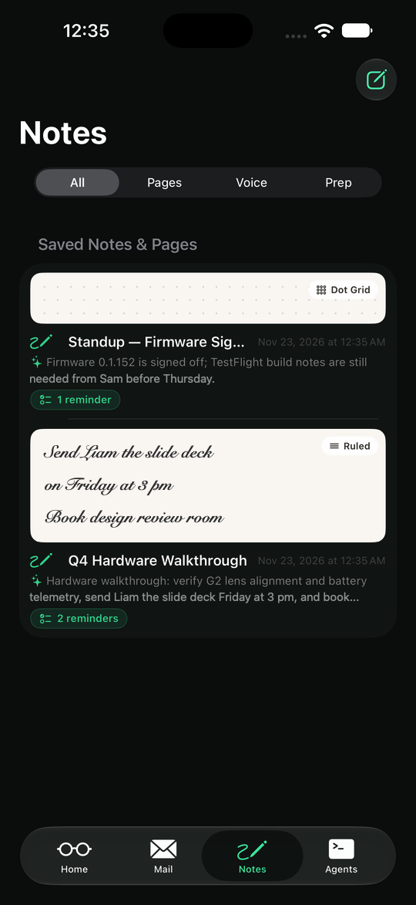
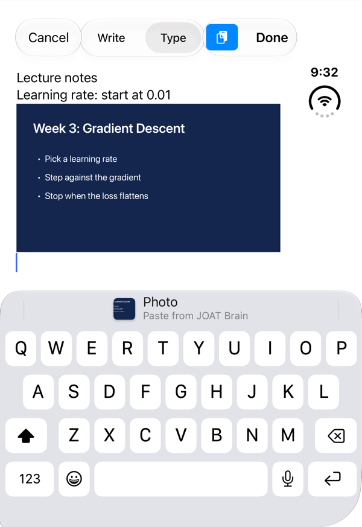
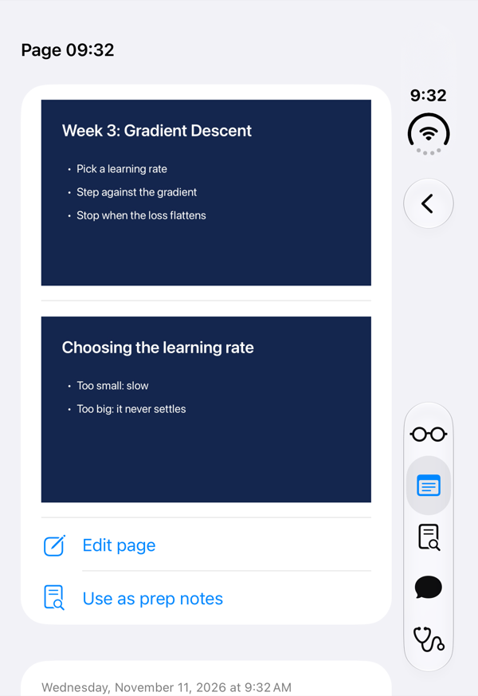
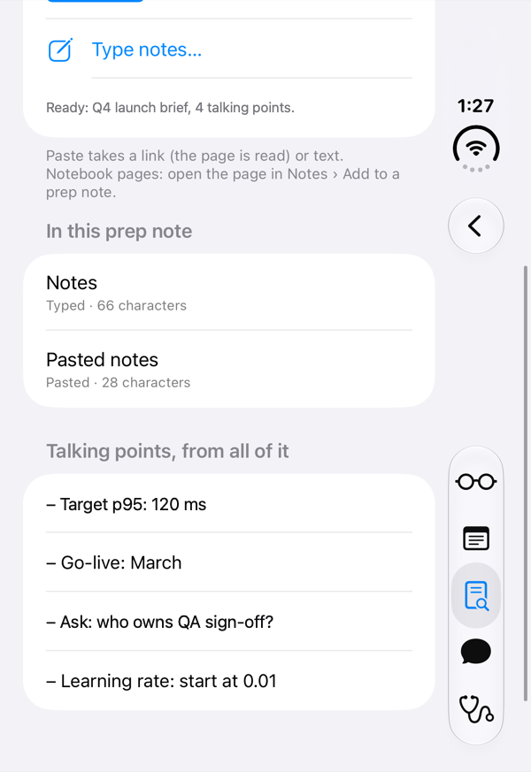

# JOAT Brain (iPhone)

JOAT Brain is the brain on the iPhone, so the glasses work with no Mac in the loop. The JOAT plugin in the Even app connects to it on the same phone (`ws://127.0.0.1:8787`). JOAT Brain keeps running behind the Even app with the screen locked. Source: [`apps/ios-companion`](../apps/ios-companion).

The screenshots are from the iPhone Duo simulator, with test data.

## The app

| | | |
|:-:|:-:|:-:|
|  **Home**: connection, listening, Claude, and the steps to connect the glasses |  **Notes**: QuickNotes from the glasses and notebook pages in one list; ✎ starts a page |  **Prep**: prep notes, each a folder of what the AI cues answer from |
|  **Messages**: whether texts reach the glasses and replies send, with the setup |  **Diagnostics**: the glasses link, audio and speech; the glasses' mic check | |

## The notebook

Notes › ✎ opens a page. **Write** draws with the Apple Pencil, or a finger unless iOS is set to draw with Apple Pencil only. **Type** types on the same page, under the ink.

A page is US Letter paper, with more sheets added as you write. It's the same page on every screen: it opens zoomed to fill the screen's width, so folding or unfolding the phone zooms it without moving anything on it.

| | | | |
|:-:|:-:|:-:|:-:|
|  **Write**: Apple's pen, pencil, marker, eraser and lasso |  **Type**: the keyboard, or Scribble with the Pencil |  **Zoom**: pinch with two fingers; the ink stays sharp |  **Saved**: Claude reads the handwriting and titles the page |
|  **Paste**: a screenshot of a slide, in line with the typing |  **Saved**: the slides on the page; Claude reads their words too | | |

- **Scroll:** two fingers in Write, one finger in Type. Zoomed in, the page scrolls sideways too.
- **Zoom:** pinch, in either mode.
- **Eraser:** lifting the Pencil after an eraser stroke goes back to the pen, pencil or marker you had before.
- **Paste:** words or images, such as a screenshot of a course slide. In Type, the edit menu's Paste puts them at the cursor. The Paste button in the toolbar works in Write too, at the end of the page. Each image sits on its own line, as wide as the page.
- **Done** saves the page. Claude reads the handwriting, and the words in pasted images, into text, then writes the title, the overview and the next steps, and offers reminders, as for a voice note. The page shows on the glasses in QuickNotes.
- **Kept as you write:** the page saves itself a moment after each change. If it closes any way other than Cancel (JOAT Brain stops, say), it's saved as Done would have.
- **The saved page:** Edit page, and Use as prep notes (the AI cues then answer from it). Read my handwriting (or Read the pasted images) shows when the page couldn't be read (offline, or no Claude key).

## Prep notes

As in Even's Conversate, a prep note holds everything for one conversation: typed notes, files (PDF, text, RTF, web pages), links and notebook pages, as many as you need.

| | |
|:-:|:-:|
|  **Prep**: the prep notes; the ticked one is in use |  **A prep note**: what's in it, and the talking points from all of it |

- **Make one:** Prep › New prep note, name it, then Add files…, Paste (a link or text) or Type notes…. A file shared to JOAT Brain from another app asks which prep note it goes into, or a new one. A notebook page: Notes › the page › Add to a prep note….
- **Talking points:** Claude writes up to eight from everything in the prep note, and writes them again when something is added or removed.
- **In use:** the ticked prep note. On the glasses, QuickNotes › + Create new note asks which prep note to use, or Skip & start. The AI cues answer from every item in the prep note in use.
- **During the note:** in the note's menu (tap, then long press), Prep notes for the talking points, or AI cues.

## QuickNotes on the glasses

- **Tap** the open note: record, or pause. **Long press:** talk one paragraph, as in Even's QuickNote. **2x tap:** Save, Discard or Cancel.
- **AI cues and Prep notes** are in the note's menu (tap, then long press), with Undo last input. The tap that opens the menu doesn't change the recording.

## The glasses' mic & Bluetooth coexistence

Diagnostics › **The glasses' mic & log export** and **Bluetooth & R1 Ring Coexistence** inspect live audio and BLE activity:

- While a note records, the log gets the glasses' sound level once a second (frames, RMS and peak in dBFS).
- **Save note audio** (off by default) keeps each note's audio on the phone as a WAV, to share and listen to. Swipe one to delete it.
- **Share the log (.txt)** exports `joat-brain-diagnostics.txt` and **Copy log to clipboard** copies the newest log lines directly.
- **Glasses Mic Mode (`joat.mic.mode`):** switch live between **Always On (Glasses Mic)**, **Hold to Talk (R1-Safe)** (`0` idle BLE audio packets/sec near Even R1, AirPods, or car Bluetooth), and **Phone Mic (R1-Safe)** while tracking G2 vs. R1/accessory status events and Classic BT `AVAudioSession` route switches.

## JOAT Assistant on the phone

Addressing `"JOAT, …"` (or speaking inside the follow-up window) runs polite lead-in normalization (`"can you please …"`, `"could you …"`, `"I'd like you to …"`) through deterministic voice commands first, and streams everything else on-phone through `OnPhoneAI` (user-selectable `Gemini 3.5 Flash Lite`, `Gemini 4 Hydrogen / Argon / Neon / Carbon`, `Gemini 3.8 Flash`, custom/live-fetched Google AI models, or `Claude`, with `MacLink` `/agent` fallback) wired to the 30-tool `PhoneToolBelt`:

- **Personal data & actions:** reads iPhone Calendar events (`NSCalendarsFullAccessUsageDescription`, managed in Home › Permissions) and Reminders, multi-account Gmail threads, Messages conversations, iPhone Contacts (plus remembered relationships like `"Mom"` or `"my wife"`), Saved Places, QuickNotes, Voice Notes, Apple Pencil Notebook pages (typed text + handwriting OCR + summaries), and Prep folders; controls countdown/Pomodoro timers, live Open-Meteo weather, RSS news, DuckDuckGo web search, glasses surfaces (`Home`, `Mail`, `Messages`, `Reminders`, `Navigation`, `QuickNotes`, `Agent Terminal` for Claude/Codex/Antigravity), Mac Agent Terminal status, notifications, and headphone spoken-reply settings.
- **Hardware confirmation safety:** preparing an email or text message, or creating or completing a reminder, dismisses the streaming `assistant.conversation` card first and opens `ConfirmGate` on the glasses—nothing is sent or written to EventKit until you tap the touchpad to confirm.

## Navigation & Places

Home › **Navigation & Places** manages Saved Places (`Home`, `Work`, custom pins, or your current iPhone GPS point), searches Apple Maps with live autocomplete, previews routes on an interactive map (side-by-side split view on unfolded iPhone Duo), and starts **Walk**, **Cycle**, or **Drive** guidance directly on the Even G2 lens.

- **On the glasses:** the `NAVIGATION` menu lists active route controls (`Show active guidance`, `Stop navigation`), `Navigate to a place…` with live speech-in-text (`Where to?`), and 1-tap Saved Places. Spoken triggers such as `"walk to …"`, `"bike to …"`, and `"drive home"` pre-select the travel mode automatically.
- **Hybrid firmware + vector route schematic (`NavigationCard.ts`, `NavigationSchematic.ts`):** active guidance pairs a uniform borderless header spine and native firmware text column (`~83 ms` in-place distance/maneuver/ETA upgrades on 1-second GPS ticks) on the left with a single `264×144` route-quantized heading-up vector diagram on the right (fixed wearer chevron, bright remaining route, dim travelled route, ringed next-maneuver node with street name, cross-street stubs, and dashed off-route connector).
- **Lock-screen GPS & headphone cues:** `PhoneLocation` uses `WhenInUse` authorization and arms `CLBackgroundActivitySession` + the iOS blue navigation indicator **only** while an active turn-by-turn route is running, streaming single-source `navigation.fix` updates and speaking concise turn prompts into connected headphones when **Spoken turn-by-turn cues** is on.

## Messages & Agent Terminal over Mac Relays

With a home Mac running `JOAT.app` (Private Tailnet on), `Messages`, `Agent Terminal` (**Claude**, **Codex**, **Antigravity**), and `Activity` keep the Even Hub WebSocket pinned locally to `JOAT Brain` on the iPhone (`ws://127.0.0.1:8787/glasses`) so speech recognition and JOAT Assistant stay on-device, while `JOAT Brain` reaches your Mac in the background over Tailscale HTTPS:

- **`/messages` (`MacMessages.swift`):** reads full macOS `chat.db` thread history, searches threads (`?q=`), and sends iMessages without Shortcuts automations. Without a home Mac, two optional iOS Shortcuts automations ([apps/ios-companion/Shortcuts](../apps/ios-companion/Shortcuts/README.md)) relay incoming and outgoing texts on the phone alone.
- **`/terminal` (`MacTerminal.swift` + `GlassesTerminal.swift`):** drives the 3-level G2 `Agent Terminal` (`AGENT TERMINAL` → session picker → 5-container framed session card with `[!] Approval needed` touchpad gates and iPhone-transcribed spoken instructions), while the **Agents** tab on the phone manages models, workspaces, accounts, and new sessions.

## Build your own

You need a Mac with Xcode and [XcodeGen](https://github.com/yonaskolb/XcodeGen) (`brew install xcodegen`), an Apple Developer account, and an iPhone with Developer Mode on (Settings › Privacy & Security › Developer Mode), paired in Xcode › Window › Devices.

1. In the repo: `cp .env.example .env`, then set `JOAT_TEAM_ID` to your Apple team ID.
   - Optional: `ANTHROPIC_API_KEY` for answers, note summaries and handwriting. `scripts/build_ios.sh` builds it into the app, so keep your build to yourself.
2. Give the app your own bundle ID. `com.joat.brain` is taken, so change it in `apps/ios-companion/project.yml` (`PRODUCT_BUNDLE_IDENTIFIER`) and `scripts/build_ios.sh` (`BUNDLE_ID`).
3. `./scripts/build_ios.sh --install --device "<your iPhone's name>"`
4. Pack your plugin with the phone first. In `apps/hub-plugin/.env`, set `JOAT_RELEASE_ALLOW_LOOPBACK=1` and put `ws://127.0.0.1:8787/glasses` first in `JOAT_RELEASE_WS_URLS` (see `apps/hub-plugin/.env.example`). Then `npm ci && npm run pack`, and upload `joat.ehpk` to your Even Hub project.
5. Connect: open the Even Realities app, start JOAT from the glasses' menu (or Even Hub › JOAT), and if JOAT asks which brain to use, pick "This iPhone · JOAT Brain".
6. Messages: run `make_shortcuts.py` with your team and bundle ID, then install the shortcuts ([how](../apps/ios-companion/Shortcuts/README.md#your-own-build)).
