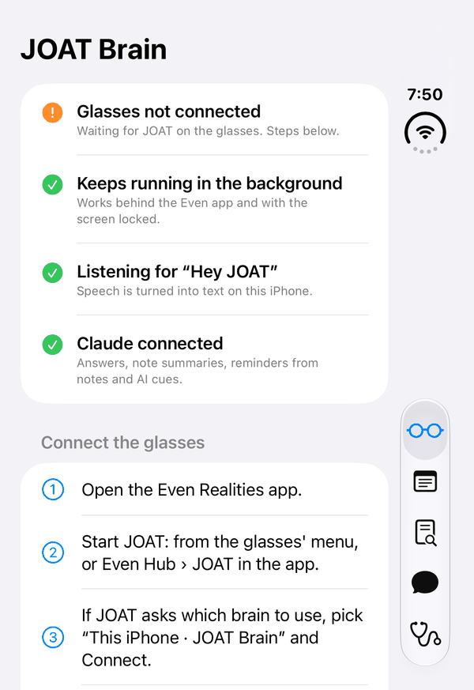
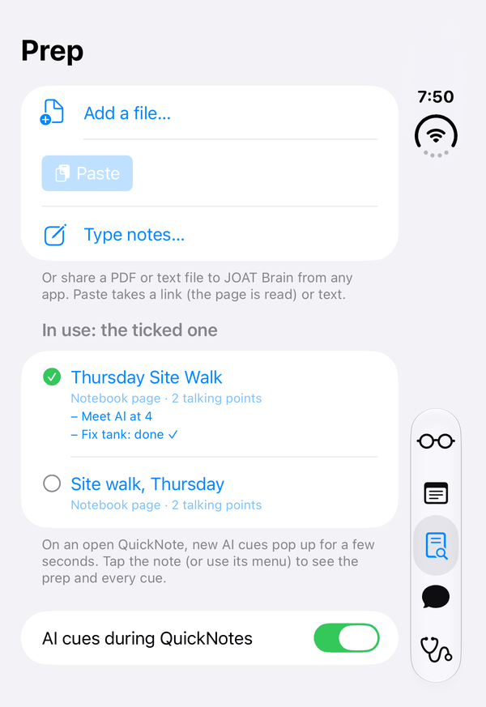
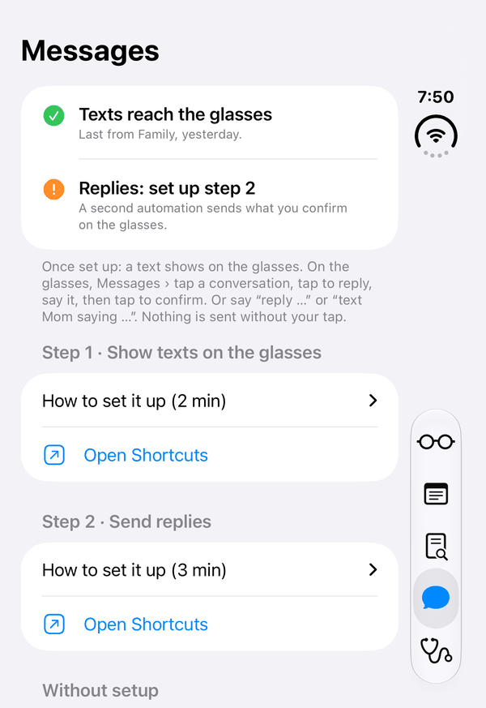
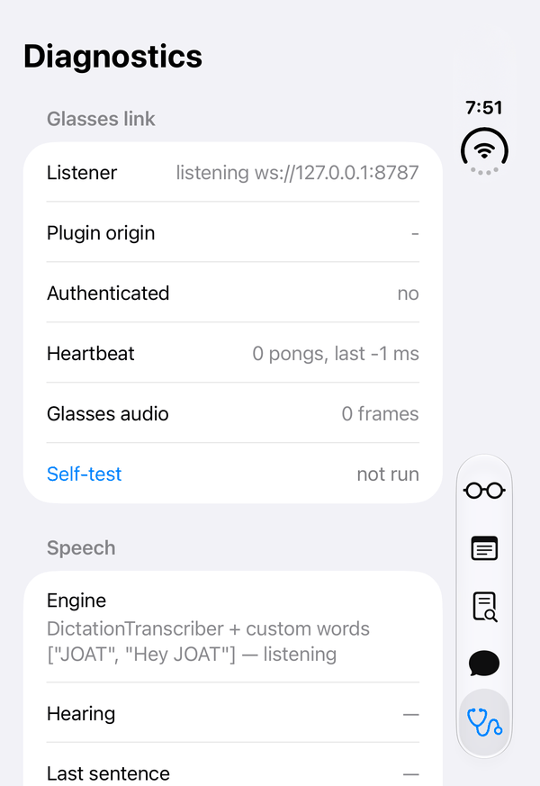
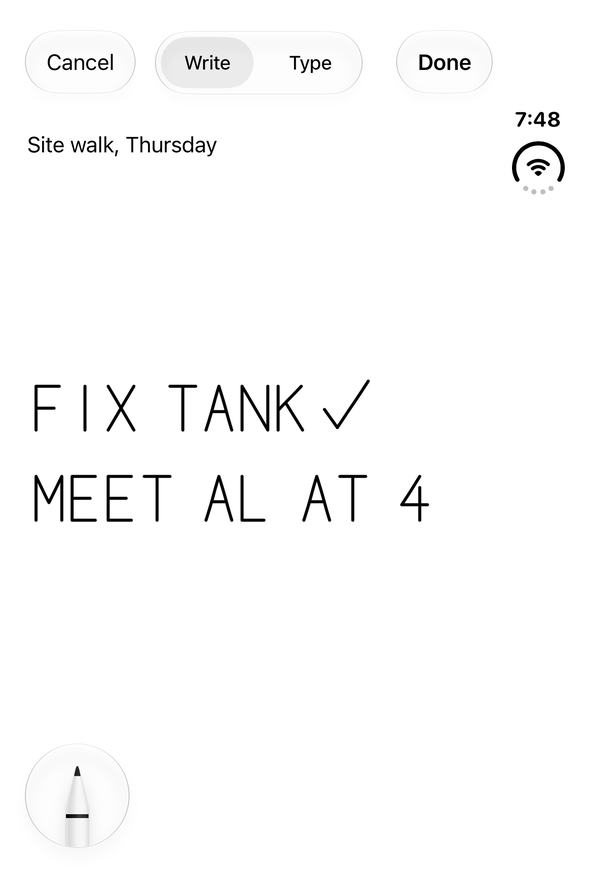
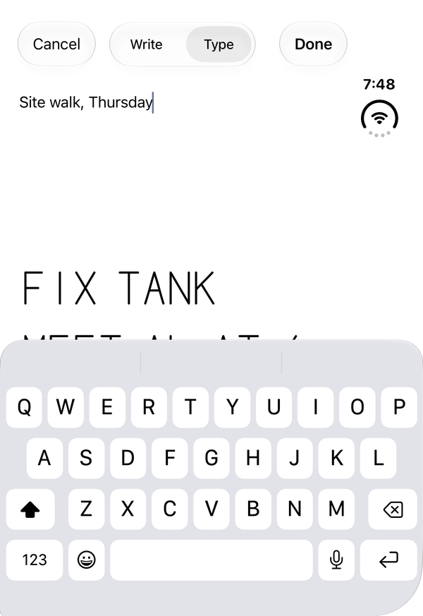
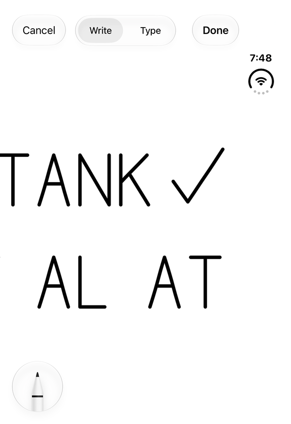
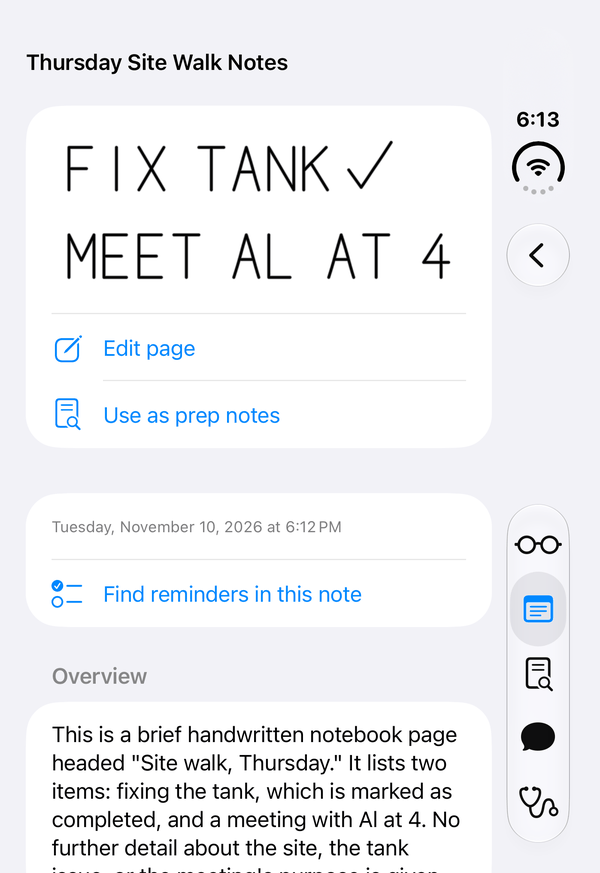

# JOAT Brain (iPhone)

JOAT Brain is the brain on the iPhone, so the glasses work with no Mac in the loop. The JOAT plugin in the Even app connects to it on the same phone (`ws://127.0.0.1:8787`). JOAT Brain keeps running behind the Even app with the screen locked. Source: [`apps/ios-companion`](../apps/ios-companion).

The screenshots are from the iPhone Duo simulator, with test data.

## The app

| | | |
|:-:|:-:|:-:|
|  **Home**: connection, listening, Claude, and the steps to connect the glasses |  **Notes**: QuickNotes from the glasses and notebook pages in one list; ✎ starts a page |  **Prep**: the notes the AI cues answer from (a file, a link, typed, or a notebook page) |
|  **Messages**: whether texts reach the glasses and replies send, with the setup |  **Diagnostics**: the glasses link, audio and speech | |

## The notebook

Notes › ✎ opens a page. **Write** draws with the Apple Pencil, or a finger unless iOS is set to draw with Apple Pencil only. **Type** types on the same page, under the ink.

| | | | |
|:-:|:-:|:-:|:-:|
|  **Write**: Apple's pen, pencil, marker, eraser and lasso |  **Type**: the keyboard, or Scribble with the Pencil |  **Zoom**: pinch with two fingers; the ink stays sharp |  **Saved**: Claude reads the handwriting and titles the page |

- **Scroll:** two fingers in Write, one finger in Type.
- **Zoom:** pinch, up to 4×, in either mode.
- **Eraser:** lifting the Pencil after an eraser stroke goes back to the pen, pencil or marker you had before.
- **Done** saves the page. Claude reads the handwriting into text, then writes the title, the overview and the next steps, and offers reminders, as for a voice note. The page shows on the glasses in QuickNotes.
- **The saved page:** Edit page, and Use as prep notes (the AI cues then answer from it). Read my handwriting shows when the page couldn't be read (offline, or no Claude key).

## Messages

Texts reach the glasses and replies send from your number through two Shortcuts automations: [apps/ios-companion/Shortcuts](../apps/ios-companion/Shortcuts/README.md) has them ready to install. JOAT Brain › Messages has the same steps to build them by hand.

## Build your own

You need a Mac with Xcode and [XcodeGen](https://github.com/yonaskolb/XcodeGen) (`brew install xcodegen`), an Apple Developer account, and an iPhone with Developer Mode on (Settings › Privacy & Security › Developer Mode), paired in Xcode › Window › Devices.

1. In the repo: `cp .env.example .env`, then set `JOAT_TEAM_ID` to your Apple team ID.
   - Optional: `ANTHROPIC_API_KEY` for answers, note summaries and handwriting. `scripts/build_ios.sh` builds it into the app, so keep your build to yourself.
2. Give the app your own bundle ID. `com.joat.brain` is taken, so change it in `apps/ios-companion/project.yml` (`PRODUCT_BUNDLE_IDENTIFIER`) and `scripts/build_ios.sh` (`BUNDLE_ID`).
3. `./scripts/build_ios.sh --install --device "<your iPhone's name>"`
4. Pack your plugin with the phone first. In `apps/hub-plugin/.env`, set `JOAT_RELEASE_ALLOW_LOOPBACK=1` and put `ws://127.0.0.1:8787/glasses` first in `JOAT_RELEASE_WS_URLS` (see `apps/hub-plugin/.env.example`). Then `npm ci && npm run pack`, and upload `joat.ehpk` to your Even Hub project.
5. Connect: open the Even Realities app, start JOAT from the glasses' menu (or Even Hub › JOAT), and if JOAT asks which brain to use, pick "This iPhone · JOAT Brain".
6. Messages: run `make_shortcuts.py` with your team and bundle ID, then install the shortcuts ([how](../apps/ios-companion/Shortcuts/README.md#your-own-build)).
