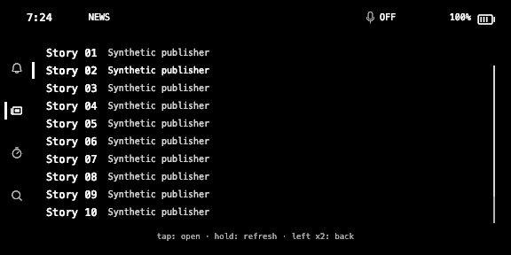
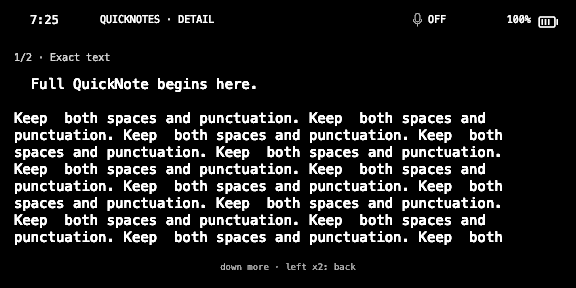

# Compact JOAT UI: measured simulator review

The September 4 compact UI candidate restored the existing custom JOAT typography. This run verified banner size, News selection and wider Note pages, but **failed complete visual acceptance because Messages footer text was still cut off**. The process exit code alone is not acceptance.

## Current-source provenance

The runner copied the current working source at HEAD `8386bf5f4a69239c7f7ee84a709cf47701ea242c`, including uncommitted repairs. It did not use the historical baseline override. The [candidate manifest](evidence/remediation/compact-ui-gate-candidate.json) records 289 source-file hashes; the [gate receipt](evidence/remediation/compact-ui-gate-receipt.json) records no source changes during the run. Each journey separately records copied source before fixture instrumentation, simulator binary hash and entry URL.

The source gate passed 397 Python tests, 868 Hub tests, mypy and build. Three simulator journeys completed. Root and an independent agent inspected all 13 resulting PNGs. These are synthetic-data simulator receipts, not physical-G2 or installed-package evidence.

## Observed improvement

| Scenario | Before | After | Scope |
| --- | --- | --- | --- |
| Banner | Native JOAT MIC OFF lettering, duplicated mic status | Compact custom page label; mic state at the right | Matching existing JOAT font family and compact geometry |
| News list | Four full rows and a clipped fifth | Ten full rows | Same synthetic story list |
| News Back | Earlier highlight/target mismatch | Story 02 visibly selected; next tap reopens Story 02 | Actual simulator gesture and controller target |
| Same saved Note | 861 characters over three pages | Exact 861 characters over two pages | Source and received SHA256 agree |
| Note first-page occupied text width | 393 px | 488 px, a 24.2% increase | Measured grayscale pixel bounds on identical 576x288 screenshots |

The Note source/received hash is `cd9c1d014ecab6aa0d1abc8913f1d7a65d5b068ebcbe59101b32f8c766e944a0`. [Pixel measurements and journey metrics](evidence/remediation/compact-ui-pixel-measurements.json) retain the measurement method and coordinates. Occupied width is not a readability score.

## Failed criterion and targeted follow-up

The Messages conversation screenshot ends its Back hint at `bac`. Both Mac `HudList.to_wire` and Hub list-option normalization applied a 46-character cap to the footer. Those limits now allow 96 characters while retaining the compact footer face. The focused protocol tests and 74 Presenter tests pass; a test-only call to a nonexistent cleanup method was removed after it failed independently of the footer assertion. Fresh simulator footer proof is pending.

The review also kept full Message/News/Search reader acceptance open. A reproduced production-wire probe found unbroken 440-character article text reduced to 60 characters. Current follow-up replaces lossy chunking with exact prepared rows; this earlier compact run does not establish that later fix.

## Official basis and practical limits

Even documents a 576x288 canvas, four image containers up to 288x144, one event-capture container, and a single native font without font selection or size control. That supports retaining the existing raster renderer for the wearer's chosen typography. [Official Even display documentation](https://hub.evenrealities.com/docs/build/display), retrieved live September 4, 2026; [retained source](evidence/remediation/official-even-display-2026-09-04.md).

Custom banner changes and News selection can dirty image tiles. Serialized sends, unchanged-tile skipping and pacing remain. No assistant-latency improvement, physical-G2 delivery, speech recognition, real message send, package upload or complete-feature acceptance is claimed here.
