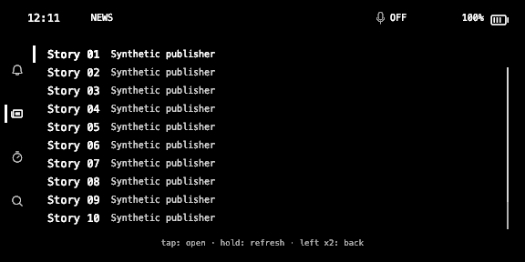
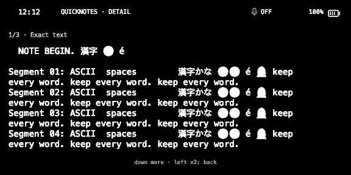
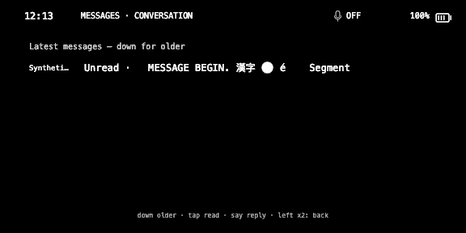
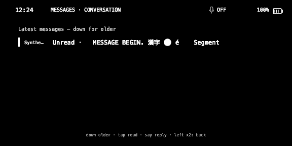
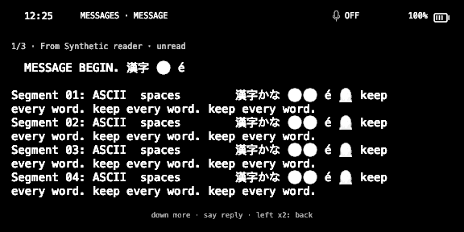

# Current UI stabilization, September 5

Feature expansion is paused after the wearer's regression challenge. The immediate gate is the existing compact appearance plus real entry, tap, reading and Back behavior. Test counts and completed processes are not substitutes for that gate.

## Fresh observations

The interactive official simulator used a copied current dirty checkout at HEAD `8386bf5f4a69239c7f7ee84a709cf47701ea242c`. All 185 copied production source hashes still matched after the run. The [receipt](evidence/remediation/sdk-current-manual-review-after/receipt.json) records source and simulator identity. Both root and an independent reviewer inspected the News, Note and conversation images separately.

- News shows the compact custom banner and ten complete rows.
- The Note reader uses the compact banner and wider content area, but emoji are visibly damaged into solid circles/silhouettes. Complete visual acceptance fails.
- The conversation has a complete footer but no selection rail on its sole readable message. Root then tapped immediately: `capmessage` arrived with index 0, the Mac reissued the same conversation, and the framebuffer SHA256 remained `371c3e390752a031b0a397feced92308a4579e26c4af9a2645c3cfccb3c5c082`.
- `current-message-first.png` therefore does **not** show a full message. Its name describes the attempted action only. It is retained as failed evidence.

## Verified first-tap mechanism

`CapabilityMenu.presentList` initializes index 0. For a conversation, that row is informational metadata; the first readable message is index 1. The renderer does not draw a message selection rail for the metadata row, and the Mac's metadata-row action only republishes the conversation. The earlier exact-reader fixture deliberately swiped down before tapping, so it passed while skipping the immediate-entry failure.

One bounded repair must select the first actual message before admitting a tap, preserve source row indices, and retain paging/Back ownership. The same simulator journey must then open the first message without that preliminary swipe. Regression tests must cover the entry action, not just the eventual reader.

## Bounded first-tap repair result

The first actual message is now selected in the initial custom frame, with no second entry paint. Conversation navigation skips informational rows; conflicting hidden native indices cannot redirect a tap away from the visible selection. Native fallback keeps its existing firmware cursor behavior. The scoped test initially had seven failures and two passing compatibility controls. After repair and a further conflicting-index case, all 960 Hub tests in 43 suites and the TypeScript/production build pass.

A fresh interactive simulator copy then showed the first message's selection rail. The immediate tap sent index 1 and opened `MESSAGES · MESSAGE`. Back restored the same highlighted message; another immediate tap reopened it. Both taps reached the full reader, compared with the earlier inert index-0 tap. All 185 copied production source hashes remained unchanged after the run. [Runtime receipt](evidence/remediation/message-first-tap-manual-after/receipt.json), [root review](evidence/remediation/message-first-tap-root-review.json), [test log](evidence/remediation/message-first-tap-final-hub.log), [build log](evidence/remediation/message-first-tap-final-build.log).

This accepts the bounded initial-tap/Back/reopen behavior in the synthetic simulator. It does not accept the remaining emoji rendering, the complete application, or the installed package. No assistant-latency improvement is claimed; the test only proves that this repair adds no second initial paint.

## Limits

These are synthetic Messages/Notes/news adapters, a temporary NoteStore and a copied Hub runtime. Fixture audio is disabled, feature entry is injected, and simulator double-Back source normalization is retained. Computer-use could not attach to the simulator executable; captures came from the official simulator framebuffer API. There is no installed-package, actual microphone, actual message send, or physical-G2 acceptance.

SDK checks and unresolved bridge/fallback issues are recorded in [EVEN_SDK_RECHECK.md](EVEN_SDK_RECHECK.md). No SDK requirement justifies the old oversized lettering or reserved reader width. This record does not close the broader goal.
