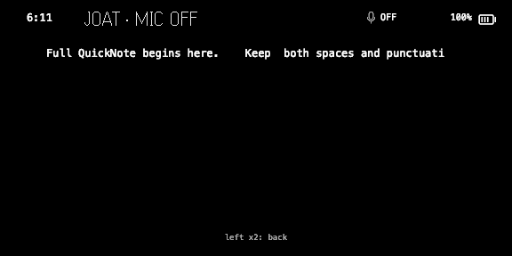
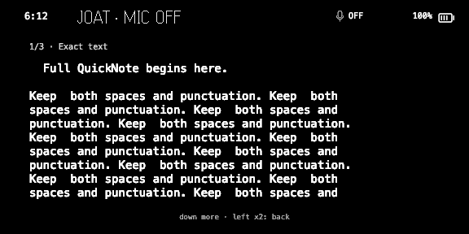
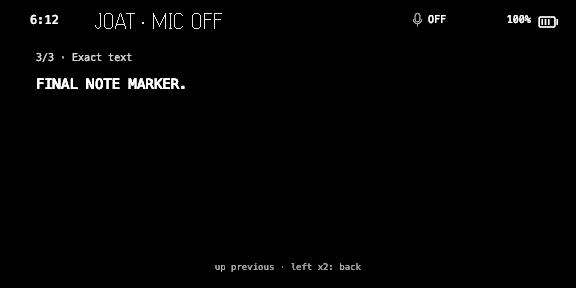
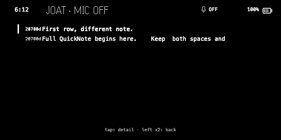
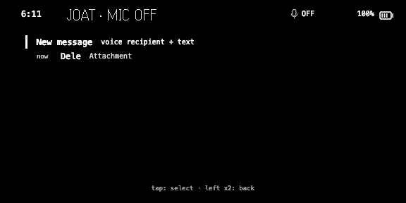
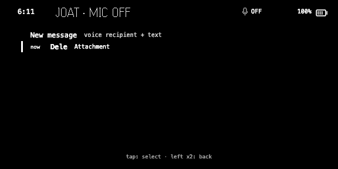
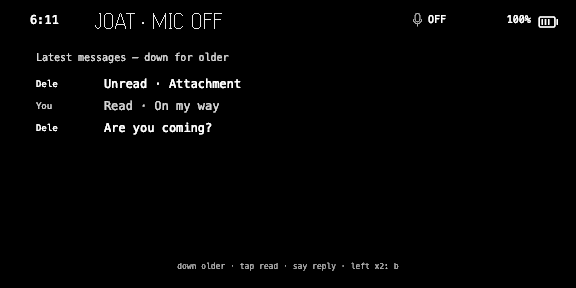
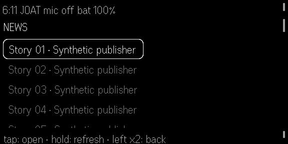

# Matched simulator repair results

**Wearer challenge, September 4:** the News native font and the Messages
monospace raster font do not form a consistent interface. The supplied
simulator screenshots also show a clipped Messages footer. The interaction
receipts below remain bounded behavior evidence; they do not establish
acceptable cross-feature typography. That visual acceptance gate failed.

September 4, 2026. All eight before/after runs completed, with source unchanged
during execution. Root and an independent agent visually inspected all 34
captures. **Overall visual acceptance remains incomplete:** the images exposed
a News selection defect despite the runner's successful exit. A suspected
blank picker was withdrawn after direct single-image inspection.

| Journey | Original behavior | Repaired behavior observed | Acceptance |
|---|---|---|---|
| QuickNotes: discard prompt, Back, Save | Save dispatched discard and displayed “Discarded Voice Note.” | Back kept the recording; Save dispatched stop and displayed the saved fixture | Interaction improved; the separate real-controller persistence fixture also passes |
| Messages: older/newer | Zero paging requests; older content unreachable | Two requests; older content and latest content both reached | Matched controller and visual improvement |
| Messages: Back and reopen | Visible highlight returned to New message; tapping did not reopen history | Dele remains visibly selected; the next tap reopens Dele | Matched controller and visual improvement |
| Saved text note | Only 64 of 861 source characters reached the reader | All 861 characters across three pages; exact text hash, counters, picker and final marker verified | Matched controller and visual improvement |
| News: select, Back, select | Article opens; Back highlights Story 01 while the next tap opens Story 02 | Same result and identical pixels | No causal improvement demonstrated; selection mismatch remains |

## Saved note: 64 characters became the complete text

Before:

After, first and last pages:

why 

The initial picker looked blank in the batched image-tool display. Direct
single-image inspection by root and the independent agent shows both rows
and the first-row highlight; the retained raw hash matches the capture
receipt. No file or production code changed between those inspections.
The suspected blank-picker product finding is withdrawn.

## Messages: the visible target now matches the reopened conversation

## News still needs a repair

Both original and repaired runs successfully rebuilt native lists. All three
before/after image pairs are byte-identical. The recovery path added for
native rejection was therefore not exercised here. Back restores logical
selection 1 but the firmware highlights row 0; the following tap opens row 1.
An internal selectedIndex assertion failed to detect the visible mismatch.

## Evidence and limits

- [Frozen run receipt](evidence/remediation/wave2-visual-receipt.json)
- [Visual review and hashes for all 34 captures](evidence/remediation/wave2-visual-review.json)
- [Picker review correction](evidence/remediation/wave2-visual-review-correction.json)
- [Production note-persistence receipt](evidence/remediation/note-persistence-after.json)
- [Official contracts and source citations](REPAIR_SOURCES.md)

The fixture uses the official simulator with synthetic data, disabled host
microphone and explicit normalization of its right-only double-click source
to exercise left-temple Back. It does not establish physical-G2 behavior,
real transcription, Apple message delivery or assistant latency. Reported
run duration includes deliberate waits and must not be used as a latency
improvement. The longer multi-feature sequence and recording-transcript
visual acceptance remain open. These results apply to the frozen Wave 2
candidate, before the next prompted-input implementation.
